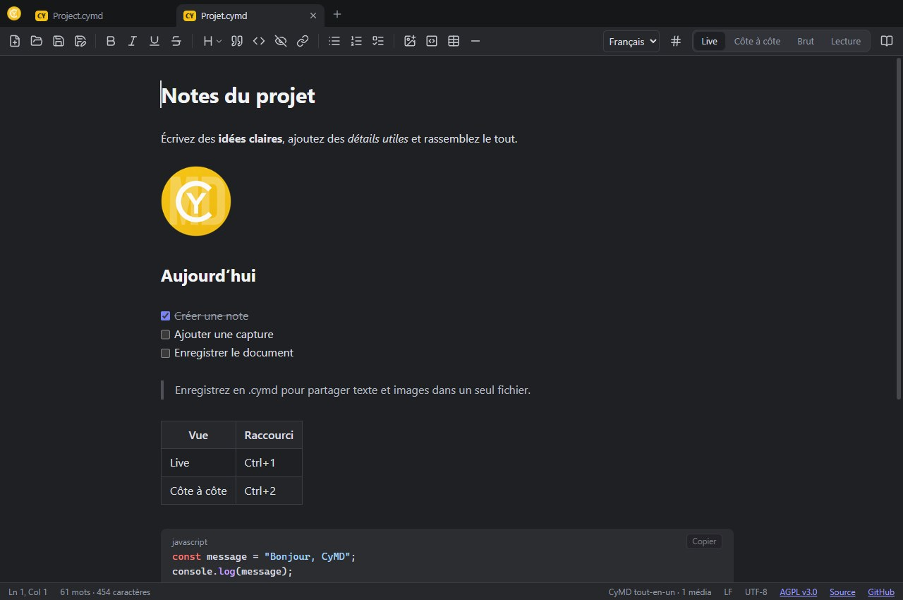
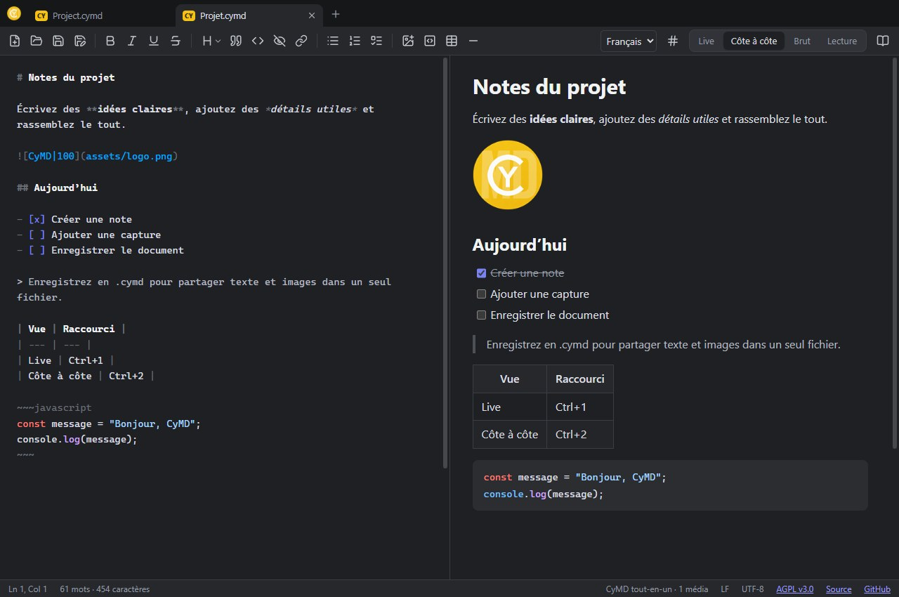
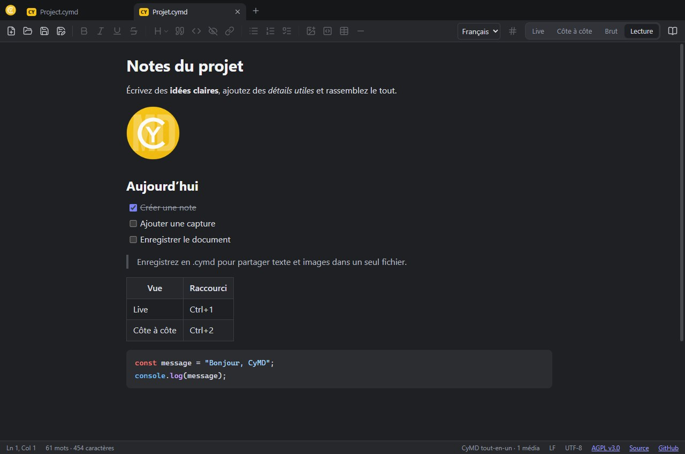

<table width="100%">
  <tr>
    <td width="300" align="left" valign="top">
      <a href="https://mrmybal.github.io/CyMD/?lang=fr">Présentation</a><br>
      <a href="https://mrmybal.github.io/CyMD/Documentation/Documentation.html#/fr/overview">Manuel</a><br>
      <a href="https://github.com/MrMybal/CyMD">Dépôt</a><br><br>
      <sub>README</sub><br>
      <a href="README.md">English</a> · <a href="README.fr.md">Français</a>
    </td>
    <td width="400" align="center" valign="middle">
      
    </td>
    <td width="300" align="right" valign="top">
      <p><sub>Licence de l’application</sub><br><a href="LICENSE"><strong>AGPL-3.0-only</strong></a></p>
      <p><sub>Version</sub><br><a href="release-notes.md#changements"><strong>0.1.6</strong></a><br><strong>EN DÉVELOPPEMENT</strong></p>
      <p><a href="https://github.com/MrMybal/CyMD/releases/tag/v0.1.6"><strong>Télécharger</strong></a><br><sub>Windows · macOS · Linux</sub></p>
    </td>
  </tr>
</table>

<h1 align="center">CyMD</h1>

Éditeur et lecteur Markdown pour les notes de projet, les guides illustrés et les fichiers README. CyMD réunit une interface familière de bloc-notes, un rendu en direct et des documents locaux sur Windows, macOS, Linux et dans le navigateur.

> **EN DÉVELOPPEMENT · 0.1.6**
>
> Version de développement publiée, avec une icône dédiée aux documents `.cymd` sur Windows et macOS. Gardez une sauvegarde des fichiers importants. Consultez les [notes de version et limites documentées](release-notes.md#changements).

<a id="aperçu-de-lapplication"></a>
<a id="écrire-en-mode-live"></a>

[](.CyDocBuild/assets/cymd-live-fr.jpg)

## À propos de CyMD

Écrivez directement en vue **Live** sans balises Markdown, comparez le texte et son aperçu **Côte à côte**, modifiez le **Brut**, ou passez en **Lecture**. Gardez plusieurs notes dans des onglets et utilisez les outils de mise en forme près de votre sélection.

Enregistrez des fichiers `.md` avec leurs médias dans un dossier voisin, ou partagez une seule archive `.cymd` contenant le texte, les images et les aperçus de liens en cache. Les fichiers restent sur votre appareil ; CyMD ne nécessite pas de compte et ne fournit pas de sauvegarde dans le cloud.

<a id="comparer-le-markdown-et-son-aperçu"></a>

[](.CyDocBuild/assets/cymd-split-fr.jpg)

<a id="lire-le-document"></a>

[](.CyDocBuild/assets/cymd-read-fr.jpg)

### Deux formats

<details>
<summary>Formats de fichiers, médias et structure de l’archive</summary>

### `.md` : Markdown simple (mode dossier)

Un fichier texte standard. Les images et vidéos référencées sont lues **dans le dossier du fichier et ses
sous-dossiers** (``). Les médias collés sont écrits dans un sous-dossier
`assets/` à l'enregistrement. L'encodage, le BOM et les fins de ligne (CRLF/LF) du fichier sont conservés.

### `.cymd` : document tout-en-un

Une archive **ZIP** (comme `.docx`/`.epub`) qui regroupe tout ; on peut l'ouvrir avec 7-Zip :

```
mimetype          application/x-cymd
manifest.json     { format, version, main, created, modified }
document.md       le texte Markdown
previews.json     aperçus de liens { url: { title, description, image, … } }
assets/…          images, vidéos, fichiers
previews/…        miniatures des aperçus (lisibles hors connexion)
```

Les médias qui ne sont plus utilisés dans le texte ne sont pas enregistrés.
*Fichier → Enregistrer sous* permet de passer d'un format à l'autre : les fichiers du dossier sont
regroupés dans le `.cymd`, ou extraits à côté du `.md`.

</details>

## Fonctionnalités

- **Français et anglais** : choix dans la barre d'outils ou **Affichage → Langue**, mémorisé
  entre les lancements et synchronisé entre fenêtres. Le système choisit le français pour les
  langues système francophones, l'anglais sinon. Le changement préserve les documents et l'annulation.

- **Onglets façon Chrome** : plusieurs documents par fenêtre ; glisser un onglet pour le réordonner, vers
  une autre fenêtre, ou hors de la fenêtre pour en créer une nouvelle. Un fichier ouvert depuis
  l'explorateur arrive en onglet dans la fenêtre déjà ouverte (pas de nouveau démarrage).
- **Barre d'outils** (fichiers + mise en forme) et **barre flottante sur la sélection**, comme sur Discord :
  gras, italique, souligné (`<u>…</u>`), barré, citation, code, spoiler (`||…||`), lien.
- **Numéros de ligne** en option (bouton `#` ou menu Affichage).
- **4 vues** : *Live* (par défaut, mise en forme en direct sans afficher les balises Markdown),
  *Côte à côte* (brut + aperçu, défilement synchronisé), *Brut* (texte seul) et *Lecture*.
- **Copier-coller** : image collée (capture d'écran…) → ajoutée au document ; HTML d'une page web ou de
  Word → converti en Markdown ; URL collée sur une sélection → lien ; `Ctrl+Shift+V` → texte brut.
- **Glisser-déposer** d'images, vidéos et fichiers ; un `.md`/`.cymd` déposé est ouvert.
- **Aperçus de liens** façon Discord sous chaque URL « nue » (Open Graph, YouTube lisible dans l'aperçu).
  `<https://…>` entre chevrons = pas d'aperçu.
- Images redimensionnables : ``.
- Rechercher / remplacer, correcteur orthographique, thème clair/sombre, export HTML autonome.


<a id="raccourcis"></a>

<details>
<summary>Raccourcis</summary>

| Raccourci | Action |
| --- | --- |
| Ctrl+T (ou Ctrl+N) / Ctrl+Shift+N | Nouvel onglet / nouvelle fenêtre |
| Ctrl+W / Ctrl+Shift+W | Fermer l'onglet / la fenêtre |
| Ctrl+Tab / Ctrl+Shift+Tab | Onglet suivant / précédent |
| Ctrl+O, Ctrl+S, Ctrl+Shift+S | Ouvrir (plusieurs fichiers possibles), enregistrer, enregistrer sous |
| Ctrl+1 … Ctrl+4 | Live, Côte à côte, Brut, Lecture |
| Ctrl+B / I / U / E / K | Gras, italique, souligné, code, lien |
| Ctrl+Shift+X | Barré |
| Ctrl+Shift+1 / 2 / 3 | Titre 1 / 2 / 3 |
| Ctrl+Shift+8 / 7 / 9 / . | Liste à puces / numérotée / cases à cocher / citation |
| Tab / Shift+Tab | Indenter / désindenter (listes) |
| Ctrl+F | Rechercher / remplacer |
| Ctrl+clic | Ouvrir un lien |

</details>

<a id="documentation-locale"></a>

### Documentation

Ouvrez **Aide → Documentation CyMD**, utilisez le bouton livre ou appuyez sur **F1**.
**Maj+F1** ouvre l’aide de la vue actuelle. Le manuel CyDoc bilingue comprend captures,
zoom, schémas SVG, recherche, exemples et protocole d’intégration du plugin.
Sur ordinateur, le lecteur livré s’ouvre en `file://`, sans Internet ni serveur.
L’aide web/plugin propose aussi un ZIP hors ligne : extrayez-le puis ouvrez `Documentation.html`.

---

## Installation

Node.js n’est pas nécessaire pour utiliser l’application téléchargée. Choisissez un paquet dans la [release 0.1.6](https://github.com/MrMybal/CyMD/releases/tag/v0.1.6).

<a id="formats-distribués"></a>

| Système | Sans installation | Installeur | Architecture |
| --- | --- | --- | --- |
| Windows | [Portable .exe](https://github.com/MrMybal/CyMD/releases/download/v0.1.6/CyMD-Portable-0.1.6-x64.exe) | [NSIS .exe](https://github.com/MrMybal/CyMD/releases/download/v0.1.6/CyMD-Setup-0.1.6-x64.exe) | x64 |
| macOS | [ZIP](https://github.com/MrMybal/CyMD/releases/download/v0.1.6/CyMD-0.1.6-macOS-universal.zip) | [DMG](https://github.com/MrMybal/CyMD/releases/download/v0.1.6/CyMD-0.1.6-macOS-universal.dmg) | Intel + Apple Silicon |
| Linux | [AppImage](https://github.com/MrMybal/CyMD/releases/download/v0.1.6/CyMD-0.1.6-Linux-x86_64.AppImage) | [DEB](https://github.com/MrMybal/CyMD/releases/download/v0.1.6/CyMD-0.1.6-Linux-amd64.deb) | x64 |

1. **Windows** — Lancez l’installeur et choisissez un dossier d’installation, ou démarrez l’exécutable portable.
2. **macOS** — Ouvrez le DMG et glissez CyMD dans Applications, ou extrayez le ZIP. Intel et Apple Silicon sont inclus.
3. **Linux** — Rendez l’AppImage exécutable (`chmod +x CyMD-*.AppImage`), ou installez le DEB avec votre gestionnaire de paquets. L’AppImage peut nécessiter FUSE.

Les paquets Windows et macOS ne disposent pas de signature de distribution ; les paquets macOS ne sont pas notarisés. Il n’existe pas de version Android native. L’icône des documents `.cymd` est associée par les installeurs Windows et les paquets macOS ; Linux conserve une icône générique et la version Windows portable n’enregistre pas d’association de fichiers.

### Mises à jour

La version Windows installée recherche une nouvelle release stable GitHub 15 secondes après le
démarrage. **Aide → Rechercher des mises à jour…** permet aussi de lancer la recherche manuellement.
Le téléchargement et le redémarrage demandent confirmation. L'installation est bloquée tant qu'une
fenêtre contient des documents non enregistrés. « Plus tard » conserve le téléchargement ; la même
commande permet de reprendre l'installation. Fermer normalement CyMD n'installe pas la mise à jour.

La version portable, les autres systèmes et le mode développement proposent d'ouvrir les
[releases GitHub](https://github.com/MrMybal/CyMD/releases) pour une installation manuelle.

### Version navigateur

[Ouvrez l’éditeur web](https://mrmybal.github.io/CyMD/editor.html) sans installation. Chrome et Edge permettent l’ouverture et l’enregistrement directs lorsque disponibles ; les autres navigateurs utilisent la sélection de fichiers et les téléchargements. Enregistrez avant de fermer l’onglet. Les documents ne sont pas stockés sur GitHub.

Une page web ne peut pas lire les images voisines d’un fichier `.md` local ni récupérer librement les aperçus de liens, à cause des restrictions du navigateur. Utilisez `.cymd` pour transporter les médias intégrés. Les aperçus et vidéos en ligne nécessitent Internet ; la lecture dépend aussi des codecs.

<a id="développement"></a>

## Sources, compilation et bibliothèques nécessaires

Utilisez **Node.js 22+**, npm et Git pour compiler les sources. Construisez les paquets de bureau sur leur système cible. Les dépendances sont verrouillées dans [package-lock.json](package-lock.json) ; `.CyDocBuild/vendor/` fournit la bibliothèque CyDoc utilisée par le manuel.

<details>
<summary>Compiler, lancer et maintenir CyMD</summary>

```sh
git clone https://github.com/MrMybal/CyMD.git
cd CyMD
```

```bash
npm ci
npm run dev        # Electron + Vite avec rechargement à chaud
npm run dev:web    # version navigateur seule (http://localhost:5173)
npm run build      # vérification TypeScript + build de production (dist/)
npm start          # build puis lance Electron sur dist/
npm run dist       # installeur (NSIS + portable sous Windows) dans release/
npm run dist:win   # Windows : portable + NSIS, à lancer sur Windows
npm run dist:mac   # macOS : DMG + ZIP universal, à lancer sur macOS
npm run dist:linux # Linux : AppImage + DEB x64, à lancer sur Linux
npm run dist:dir   # application non empaquetée dans release/, pour tester
```

Si Electron ne démarre pas après `npm install` (binaire manquant), lancer :
`node node_modules/electron/install.js`.

Icônes : le logo source est `assets/branding/cymd-logo-yellow.png`. Après l'avoir modifié, régénérer
toutes les icônes (exécutable, installeur, fenêtre, interface, favicon) avec
`powershell -ExecutionPolicy Bypass -File scripts/make-icons.ps1` (option `-Source autre-logo.png`).

Test de fumée automatisé (ouvre un fichier, exécute un script dans la fenêtre, enregistre une capture) :
`SMOKE_SCRIPT=etapes.js SMOKE_OUT=sortie electron scripts/smoke.cjs fichier.md`.

### Organisation

Les traductions anglaises sont centralisées dans `locales/en.json` ; les clés constituent les
textes français. Les moteurs `src/i18n.ts` et `electron/i18n.cjs` partagent ce catalogue.
Les guides intégrés existent en français et en anglais. Les fichiers utilisateur ne sont pas traduits.

```
electron/main.cjs        fenêtres, menus, fichiers, protocole cymd://, aperçus de liens (réseau)
assets/branding/         logo source pour régénérer les icônes
electron/preload.cjs     pont sécurisé vers le rendu
src/app.ts               contrôleur : documents, modes, enregistrement, médias
src/editor/              CodeMirror 6 : mode Live, widgets, commandes, copier-coller
src/preview/             rendu Markdown (markdown-it + DOMPurify) et hydratation
src/ui/                  onglets, barre d'outils, menus, icônes (Lucide)
src/embeds/              aperçus de liens et cartes façon Discord
src/doc/                 modèle de document, format .cymd, chemins, types de médias
src/platform/            Electron / navigateur
build/icon.ico, icon.png icônes de l'exécutable et de l'installeur (générées)
electron/icon.png        icône de fenêtre / « À propos » (générée)
public/logo.png          logo de l'interface et favicon (généré)
```

### Sécurité

Rendu isolé (`sandbox`, `contextIsolation`), HTML nettoyé par DOMPurify, aucune navigation dans la
fenêtre (les liens s'ouvrent dans le navigateur), protocole `cymd://` limité au dossier des documents
ouverts, liens vers des fichiers locaux jamais exécutés (affichés dans l'explorateur), aperçus de liens
récupérés dans une session réseau séparée, sans cookies.

Les icônes de document utilisent le logo d’origine sur une feuille repliée. Régénérez leurs fichiers ICO/ICNS/PNG avec `powershell -NoProfile -ExecutionPolicy Bypass -File scripts/make-document-icons.ps1` ; consultez le [guide des icônes](assets/branding/README.md).

### Préparer une release

Mettez à jour la version de l’application dans `package.json` et `package-lock.json`, la version et les liens de téléchargement de la vitrine, ainsi que `release-notes.md`. La génération du manuel synchronise sa version avec l’application. Committez, créez le tag `vX.Y.Z`, puis poussez lorsque vous êtes prêt à publier. Le workflow de bureau construit et teste les trois plateformes et crée une release brouillon. Validez les paquets et les fichiers `latest*.yml` correspondants avant publication. Un lancement manuel du workflow produit uniquement des artefacts de compilation.

### Vitrine et documentation hors ligne

`npm run build:pages` génère la vitrine, l’éditeur web, le manuel CyDoc bilingue complet et l’archive des sources dans `output/pages/`. `npm run preview:pages` lance l’aperçu local. Consultez le [guide de la vitrine](website/README.md). GitHub Pages utilise le workflow **Web editor and documentation** ; la source Pages du dépôt doit être GitHub Actions. Aucune commande de compilation locale ne publie de contenu.

</details>

### Plugin intégré

<details>
<summary>Intégrer CyMD dans une autre application</summary>

CyMD peut être affiché et édité dans une iframe au sein d'une autre application.
`npm run build:plugin` génère le bundle dans `release/plugin`, avec la licence et les sources.
Le [protocole d'intégration](docs/integration.md) fournit l'ouverture, l'état des modifications
et la sauvegarde confirmée par l'hôte.

Pour les sources locales de CyAIOrchestrator :
`node integration/cyai/install.mjs CHEMIN_VERS_CYAIORCHESTRATOR`, après construction du plugin.
Redémarrer ensuite CyAI depuis ces sources (ou reconstruire son application distribuée).
Le plugin ajoute un bouton CyMD et ouvre les pièces jointes `.cymd` dans l'éditeur.
Chaque sauvegarde ajoute une nouvelle pièce jointe ; le document original est conservé.

</details>

---

## Licence

**CyMD utilise la [GNU Affero General Public License v3.0 uniquement](LICENSE)** (`AGPL-3.0-only`). Copyright © 2026 Cyberalien. Les bibliothèques tierces conservent leurs propres licences.

### Principales bibliothèques tierces

Certains paquets déclarés comme dépendances de développement sont intégrés à l’éditeur exécuté. Les périmètres ci-dessous les distinguent des outils de compilation.

| Bibliothèque · sources | Licence · texte | Utilisation / périmètre |
| --- | --- | --- |
| [Electron](https://github.com/electron/electron) | [MIT](https://github.com/electron/electron/blob/main/LICENSE) | Exécution sur bureau ; Chromium et Node.js conservent leurs notices. |
| [CodeMirror 6 / Lezer](https://github.com/codemirror/view) | [MIT](https://github.com/codemirror/view/blob/main/LICENSE) · [Lezer MIT](https://github.com/lezer-parser/common/blob/main/LICENSE) | Éditeur, commandes, recherche et analyse ; intégrés à l’exécution. Lezer utilise aussi MIT. |
| [markdown-it](https://github.com/markdown-it/markdown-it) | [MIT](https://github.com/markdown-it/markdown-it/blob/master/LICENSE) | Rendu Markdown à l’exécution. |
| [DOMPurify](https://github.com/cure53/DOMPurify) | [Apache-2.0 OU MPL-2.0](https://github.com/cure53/DOMPurify/blob/main/LICENSE) | Nettoyage HTML à l’exécution. Conditions alternatives MPL-2.0 : [LICENSE-MPL](https://github.com/cure53/DOMPurify/blob/main/LICENSE-MPL). |
| [fflate](https://github.com/101arrowz/fflate) | [MIT](https://github.com/101arrowz/fflate/blob/master/LICENSE) | Archives ZIP des documents à l’exécution ; génération des ZIP du plugin et du manuel. |
| [highlight.js](https://github.com/highlightjs/highlight.js) | [BSD-3-Clause](https://github.com/highlightjs/highlight.js/blob/main/LICENSE) | Coloration du code dans les documents affichés. |
| [Lucide / Feather](https://github.com/lucide-icons/lucide) | [ISC + MIT](https://github.com/lucide-icons/lucide/blob/main/LICENSE) | Icônes de l’interface ; les icônes issues de Feather conservent leurs notices MIT. |
| [Turndown](https://github.com/mixmark-io/turndown) | [MIT](https://github.com/mixmark-io/turndown/blob/master/LICENSE) | Conversion du HTML collé en Markdown ; à l’exécution. |
| [turndown-plugin-gfm](https://github.com/domchristie/turndown-plugin-gfm) | [MIT](https://github.com/domchristie/turndown-plugin-gfm/blob/master/LICENSE) | Tableaux, tâches et texte barré dans le HTML collé ; à l’exécution. |
| [electron-updater / electron-builder](https://github.com/electron-userland/electron-builder) | [MIT](https://github.com/electron-userland/electron-builder/blob/master/LICENSE) | L’updater s’exécute dans l’application ; builder produit les paquets à la compilation. |
| [CyDoc](https://github.com/MrMybal/CyDoc) | [MIT](https://mrmybal.github.io/CyMD/Documentation/DocData/CyDoc-LICENSE.txt) | Génère le manuel ; lecteur et module image intégrés. L’accès aux sources est restreint. |
| [marked](https://github.com/markedjs/marked) | [MIT](https://github.com/markedjs/marked/blob/master/LICENSE) | Compilation Markdown CyDoc ; uniquement à la génération. |
| [PrismJS](https://github.com/PrismJS/prism) | [MIT](https://github.com/PrismJS/prism/blob/master/LICENSE) | Coloration du code CyDoc ; uniquement à la génération. |
| [esbuild](https://github.com/evanw/esbuild) | [MIT](https://github.com/evanw/esbuild/blob/main/LICENSE.md) | Assemblage de CyDoc et des liens d’aide ; uniquement à la génération. |
| [TypeScript](https://github.com/microsoft/TypeScript) | [Apache-2.0](https://github.com/microsoft/TypeScript/blob/main/LICENSE.txt) | Développement et vérification des types uniquement. |
| [@types/turndown](https://github.com/DefinitelyTyped/DefinitelyTyped) | [MIT](https://github.com/DefinitelyTyped/DefinitelyTyped/blob/master/LICENSE) | Définitions de types utilisées uniquement au développement. |
| [Vite](https://github.com/vitejs/vite) | [MIT + notices des composants](https://github.com/vitejs/vite/blob/main/packages/vite/LICENSE.md) | Serveur de développement et assemblage de production ; inutile pour lancer les paquets installés. |

Ce tableau répertorie les principaux composants ; il ne remplace pas leurs notices complètes et n’énumère pas toutes les dépendances transitives. Conservez les textes de licence distribués avec Electron, ses composants Chromium/Node.js, CyDoc et les autres paquets intégrés. Le fichier de verrouillage décrit les dépendances résolues. CyDoc utilise ici uniquement son module image ; Three.js et le lecteur mesh ne sont pas inclus.

## Références et liens

- [Manuel en français](https://mrmybal.github.io/CyMD/Documentation/Documentation.html#/fr/overview) · [Manuel hors ligne ZIP](https://mrmybal.github.io/CyMD/CyMD-help.zip)
- [Vitrine](https://mrmybal.github.io/CyMD/?lang=fr) · [Éditeur web](https://mrmybal.github.io/CyMD/editor.html)
- [Dépôt des sources](https://github.com/MrMybal/CyMD) · [Releases](https://github.com/MrMybal/CyMD/releases) · [Suivi des problèmes](https://github.com/MrMybal/CyMD/issues)
- [Protocole du plugin](docs/integration.md) · [Compilation de la vitrine](website/README.md)
