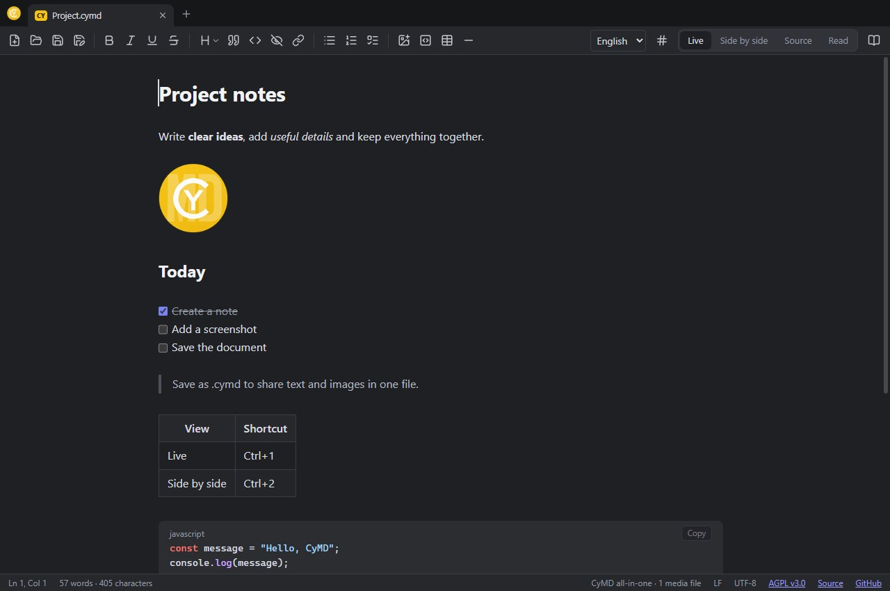
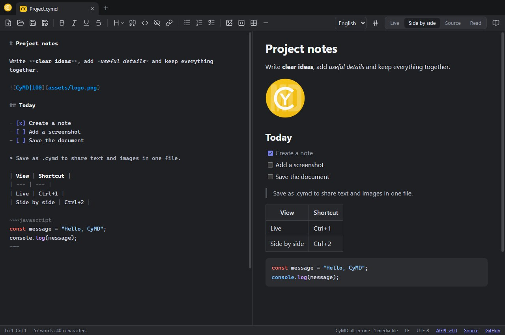
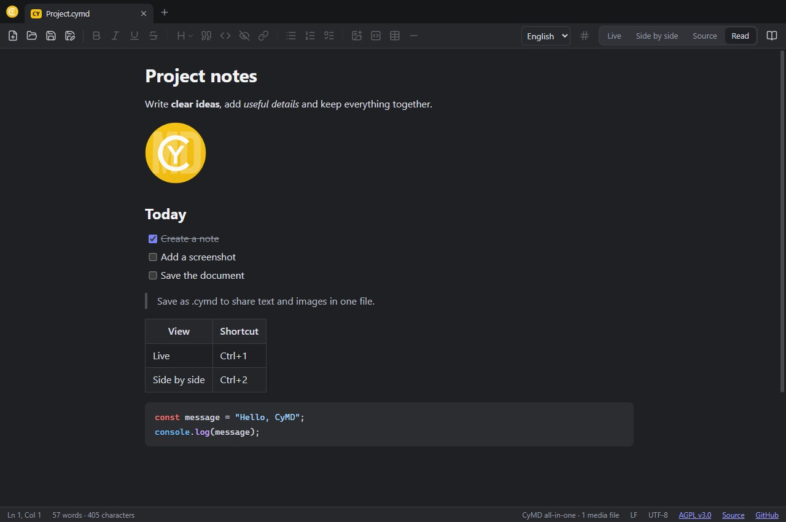

<table width="100%">
  <tr>
    <td width="30%" align="left" valign="top">
      <a href="https://mrmybal.github.io/CyMD/?lang=en">Website</a><br>
      <a href="https://mrmybal.github.io/CyMD/Documentation/Documentation.html#/en/overview">Manual</a><br>
      <a href="https://github.com/MrMybal/CyMD">Repository</a><br><br>
      <sub>README</sub><br>
      <a href="README.md">English</a> · <a href="README.fr.md">Français</a>
    </td>
    <td width="40%" align="center" valign="middle">
      
    </td>
    <td width="30%" align="right" valign="top">
      <p><sub>Application license</sub><br><a href="LICENSE"><strong>AGPL-3.0-only</strong></a></p>
      <p><sub>Version</sub><br><a href="release-notes.md#english"><strong>0.1.6</strong></a><br><strong>IN DEVELOPMENT</strong></p>
      <p><a href="https://github.com/MrMybal/CyMD/releases/tag/v0.1.6"><strong>Download</strong></a><br><sub>Windows · macOS · Linux</sub></p>
    </td>
  </tr>
</table>

<h1 align="center">CyMD</h1>

A Markdown editor and reader for project notes, illustrated guides and README files. CyMD combines a familiar notepad interface, live formatting and local documents on Windows, macOS, Linux and in the browser.

> **IN DEVELOPMENT · 0.1.6**
>
> Published development version with a dedicated `.cymd` document icon on Windows and macOS. Keep backups of important files. Read the [version notes and documented limitations](release-notes.md#english).

<a id="screenshots"></a>
<a id="write-in-live-mode"></a>

[](.CyDocBuild/assets/cymd-live-en.jpg)

## About CyMD

Write directly in **Live** view without Markdown markers, compare the source and its preview **side by side**, edit the **Source**, or switch to **Reading**. Keep several notes in tabs and use formatting tools near your selection.

Save plain `.md` files with an adjacent media folder, or share a single `.cymd` archive containing the text, images and cached link previews. Files stay on your device; CyMD does not require an account or provide cloud backup.

<a id="compare-markdown-and-its-preview"></a>

[](.CyDocBuild/assets/cymd-split-en.jpg)

<a id="read-the-document"></a>

[](.CyDocBuild/assets/cymd-read-en.jpg)

<a id="deux-formats"></a>

### Two formats

<details>
<summary>File formats, media and archive structure</summary>

<a id="md--markdown-simple-mode-dossier"></a>

### `.md`: plain Markdown (folder mode)

A standard text file. Referenced images and videos are read **from the file's folder and its
subfolders** (``). Pasted media is written to an `assets/` subfolder
when saving. The file's encoding, BOM and line endings (CRLF/LF) are preserved.

<a id="cymd--document-tout-en-un"></a>

### `.cymd`: an all-in-one document

A **ZIP** archive (like `.docx`/`.epub`) containing everything. It can be opened with 7-Zip:

```
mimetype          application/x-cymd
manifest.json     { format, version, main, created, modified }
document.md       Markdown text
previews.json     link previews { url: { title, description, image, … } }
assets/…          images, videos, files
previews/…        preview thumbnails (available offline)
```

Media no longer used in the text is omitted when saving.
*File → Save as* switches between formats: folder files are packed into a `.cymd`,
or extracted next to the `.md` file.

</details>

<a id="fonctionnalités"></a>

## Features

- **French and English**: choose in the toolbar or **View → Language**. The choice persists
  between launches and synchronizes across windows. French is selected for French system
  languages, English otherwise. Switching preserves documents and undo history.
- **Chrome-style tabs**: several documents per window. Drag tabs to reorder them, move them to
  another window, or detach them into a new window. Files opened from the file manager appear
  as tabs in the running window without starting another instance.
- **Toolbar** (files and formatting) and **floating selection toolbar**, inspired by Discord:
  bold, italic, underline (`<u>…</u>`), strikethrough, quote, code, spoiler (`||…||`) and link.
- Optional **line numbers** (`#` button or View menu).
- **Four views**: *Live* (default; live formatting without showing Markdown markers),
  *Side by side* (source and preview, synchronized scrolling), *Source* (text only) and *Reading*.
- **Copy and paste**: pasted images (such as screenshots) are added to the document; HTML from
  a webpage or Word is converted to Markdown; pasting a URL over a selection creates a link;
  `Ctrl+Shift+V` pastes plain text.
- **Drag and drop** images, videos and files; dropping a `.md`/`.cymd` opens it.
- Discord-style **link previews** below bare URLs (Open Graph, with playable YouTube previews).
  Angle-bracket URLs such as `<https://…>` do not produce a preview.
- Resizable images: ``.
- Find/replace, spell checking, light/dark themes and standalone HTML export.


<a id="raccourcis"></a>

<a id="keyboard-shortcuts"></a>

<details>
<summary>Keyboard shortcuts</summary>

| Shortcut | Action |
| --- | --- |
| Ctrl+T (or Ctrl+N) / Ctrl+Shift+N | New tab / new window |
| Ctrl+W / Ctrl+Shift+W | Close tab / window |
| Ctrl+Tab / Ctrl+Shift+Tab | Next / previous tab |
| Ctrl+O, Ctrl+S, Ctrl+Shift+S | Open (multiple files supported), save, save as |
| Ctrl+1 … Ctrl+4 | Live, Side by side, Source, Reading |
| Ctrl+B / I / U / E / K | Bold, italic, underline, code, link |
| Ctrl+Shift+X | Strikethrough |
| Ctrl+Shift+1 / 2 / 3 | Heading 1 / 2 / 3 |
| Ctrl+Shift+8 / 7 / 9 / . | Bulleted / numbered / checkbox list / quote |
| Tab / Shift+Tab | Indent / outdent (lists) |
| Ctrl+F | Find / replace |
| Ctrl+click | Open a link |

</details>

<a id="local-documentation"></a>

### Documentation

Open **Help → CyMD documentation**, use the book button, or press **F1**.
**Shift+F1** opens help for the current view. The bilingual CyDoc manual includes
screenshots, zoom, SVG diagrams, search, examples and the plugin protocol.
The desktop reader opens a bundled `file://` URL and requires no Internet or server.
The web/plugin help also offers an offline ZIP: extract it and open `Documentation.html`.

---

## Installation

Node.js is not needed to use the downloaded application. Choose a package from [release 0.1.6](https://github.com/MrMybal/CyMD/releases/tag/v0.1.6).

<a id="formats-distribués"></a>

<a id="distribution-formats"></a>

| System | Without installation | Installer | Architecture |
| --- | --- | --- | --- |
| Windows | [Portable .exe](https://github.com/MrMybal/CyMD/releases/download/v0.1.6/CyMD-Portable-0.1.6-x64.exe) | [NSIS .exe](https://github.com/MrMybal/CyMD/releases/download/v0.1.6/CyMD-Setup-0.1.6-x64.exe) | x64 |
| macOS | [ZIP](https://github.com/MrMybal/CyMD/releases/download/v0.1.6/CyMD-0.1.6-macOS-universal.zip) | [DMG](https://github.com/MrMybal/CyMD/releases/download/v0.1.6/CyMD-0.1.6-macOS-universal.dmg) | Intel + Apple Silicon |
| Linux | [AppImage](https://github.com/MrMybal/CyMD/releases/download/v0.1.6/CyMD-0.1.6-Linux-x86_64.AppImage) | [DEB](https://github.com/MrMybal/CyMD/releases/download/v0.1.6/CyMD-0.1.6-Linux-amd64.deb) | x64 |

1. **Windows** — Run the installer and choose an installation folder, or start the portable executable.
2. **macOS** — Open the DMG and drag CyMD to Applications, or extract the ZIP. Both Intel and Apple Silicon are included.
3. **Linux** — Make the AppImage executable (`chmod +x CyMD-*.AppImage`), or install the DEB with your package manager. AppImage may require FUSE.

Windows and macOS packages are not distribution-signed; macOS packages are not notarized. There is no native Android build. The `.cymd` document icon is registered by Windows installers and macOS bundles; Linux uses a generic document icon and Windows portable builds do not register file associations.

<a id="mises-à-jour"></a>

### Updates

The installed Windows version checks for a new stable GitHub release 15 seconds after startup.
**Help → Check for updates…** also starts a manual check. Downloading and restarting require
confirmation. Installation is blocked while any window contains unsaved documents. “Later”
keeps the download; the same command resumes installation. Closing CyMD normally does not
install the update.

The portable version, other operating systems and development mode offer to open
[GitHub releases](https://github.com/MrMybal/CyMD/releases) for manual installation.

<a id="version-navigateur"></a>

### Browser version

[Open the web editor](https://mrmybal.github.io/CyMD/editor.html) without installation. Chrome and Edge support direct file opening/saving where available; other browsers use file selection and downloads. Save before closing the tab. Documents are not stored on GitHub.

A webpage cannot read images next to a local `.md` file or fetch arbitrary link previews because of browser security restrictions. Use `.cymd` to carry embedded media. Online previews and videos need Internet; playback also depends on codecs.

<a id="développement"></a>

<a id="development"></a>

## Source, build and required libraries

Use **Node.js 22+**, npm and Git for source builds. Build desktop packages on their native operating system. Build dependencies are pinned in [package-lock.json](package-lock.json); `.CyDocBuild/vendor/` provides the CyDoc library used by the manual.

<details>
<summary>Build, run and maintain CyMD</summary>

```sh
git clone https://github.com/MrMybal/CyMD.git
cd CyMD
```

```bash
npm ci
npm run dev        # Electron + Vite with hot reload
npm run dev:web    # browser-only version (http://localhost:5173)
npm run build      # TypeScript checks + production build (dist/)
npm start          # build, then launch Electron using dist/
npm run dist       # installer (NSIS + portable on Windows) in release/
npm run dist:win   # Windows: portable + NSIS; run on Windows
npm run dist:mac   # macOS: universal DMG + ZIP; run on macOS
npm run dist:linux # Linux: x64 AppImage + DEB; run on Linux
npm run dist:dir   # unpackaged application in release/ for testing
```

If Electron does not start after `npm install` because its binary is missing, run
`node node_modules/electron/install.js`.

Icons: the source logo is `assets/branding/cymd-logo-yellow.png`. After changing it, regenerate
all icons (executable, installer, window, interface and favicon) with
`powershell -ExecutionPolicy Bypass -File scripts/make-icons.ps1` (option: `-Source another-logo.png`).

Automated smoke test (opens a file, executes a script in the window, saves a screenshot):
`SMOKE_SCRIPT=steps.js SMOKE_OUT=output electron scripts/smoke.cjs file.md`.

<a id="organisation"></a>

### Layout

English translations are centralized in `locales/en.json`; keys are the French text.
The `src/i18n.ts` and `electron/i18n.cjs` engines share this catalog.
Built-in guides are available in French and English. User files are not translated.

```
electron/main.cjs        windows, menus, files, cymd:// protocol, link previews (network)
assets/branding/         source logo for regenerating icons
electron/preload.cjs     secure renderer bridge
src/app.ts               controller: documents, modes, saving, media
src/editor/              CodeMirror 6: Live mode, widgets, commands, copy/paste
src/preview/             Markdown rendering (markdown-it + DOMPurify) and hydration
src/ui/                  tabs, toolbar, menus, icons (Lucide)
src/embeds/              link previews and Discord-style cards
src/doc/                 document model, .cymd format, paths, media types
src/platform/            Electron / browser
build/icon.ico, icon.png executable and installer icons (generated)
electron/icon.png        window / About icon (generated)
public/logo.png          interface logo and favicon (generated)
```

<a id="sécurité"></a>

### Security

Isolated renderer (`sandbox`, `contextIsolation`), HTML sanitized with DOMPurify, no navigation
inside the window (links open in the browser), `cymd://` restricted to the folders of open documents,
local file links never executed (shown in the file manager), and link previews fetched through
a separate network session without cookies.

Document icons use the original logo on a folded sheet. Regenerate their ICO/ICNS/PNG assets with `powershell -NoProfile -ExecutionPolicy Bypass -File scripts/make-document-icons.ps1`; see the [branding guide](assets/branding/README.md).

<a id="préparer-une-release"></a>

### Prepare a release

Update the application version in `package.json` and `package-lock.json`, the website version/download links, and `release-notes.md`. The documentation build synchronizes its version with the application. Commit, tag `vX.Y.Z`, then push when ready to publish. The desktop workflow builds and tests all three platforms and creates a draft release. Validate the packages and their matching `latest*.yml` files before publishing. A manual workflow run only creates build artifacts.

### Website and offline documentation

`npm run build:pages` generates the showcase, web editor, full bilingual CyDoc manual and source archive in `output/pages/`. `npm run preview:pages` starts the local preview. See the [website guide](website/README.md). GitHub Pages uses the **Web editor and documentation** workflow; the repository's Pages source must be GitHub Actions. No local build command publishes anything.

</details>

<a id="plugin-intégré"></a>

### Embedded plugin

<details>
<summary>Embed CyMD in another application</summary>

CyMD can be displayed and edited in an iframe inside another application.
`npm run build:plugin` generates the bundle in `release/plugin`, including the license and sources.
The [integration protocol](docs/integration.md) provides opening, modification status
and host-confirmed saving.

For local CyAIOrchestrator sources, run
`node integration/cyai/install.mjs PATH_TO_CYAIORCHESTRATOR` after building the plugin.
Then restart CyAI from those sources, or rebuild its distributed application.
The plugin adds a CyMD button and opens `.cymd` attachments in the editor.
Each save adds a new attachment; the original document is retained.

</details>

---

<a id="licence"></a>

## License

**CyMD uses the [GNU Affero General Public License v3.0 only](LICENSE)** (`AGPL-3.0-only`). Copyright © 2026 Cyberalien. Third-party libraries retain their own licenses.

### Main third-party libraries

Some packages listed as development dependencies are bundled into the running editor. The scopes below distinguish them from build tools.

| Library · source | License · terms | Use / scope |
| --- | --- | --- |
| [Electron](https://github.com/electron/electron) | [MIT](https://github.com/electron/electron/blob/main/LICENSE) | Desktop runtime; Chromium and Node.js retain their component notices. |
| [CodeMirror 6 / Lezer](https://github.com/codemirror/view) | [MIT](https://github.com/codemirror/view/blob/main/LICENSE) · [Lezer MIT](https://github.com/lezer-parser/common/blob/main/LICENSE) | Editor, commands, search and parsing; bundled at runtime. Lezer also uses MIT. |
| [markdown-it](https://github.com/markdown-it/markdown-it) | [MIT](https://github.com/markdown-it/markdown-it/blob/master/LICENSE) | Markdown rendering at runtime. |
| [DOMPurify](https://github.com/cure53/DOMPurify) | [Apache-2.0 OR MPL-2.0](https://github.com/cure53/DOMPurify/blob/main/LICENSE) | HTML sanitization; runtime. Alternative MPL-2.0 terms: [LICENSE-MPL](https://github.com/cure53/DOMPurify/blob/main/LICENSE-MPL). |
| [fflate](https://github.com/101arrowz/fflate) | [MIT](https://github.com/101arrowz/fflate/blob/master/LICENSE) | Document ZIP archives at runtime; plugin/manual ZIP generation during builds. |
| [highlight.js](https://github.com/highlightjs/highlight.js) | [BSD-3-Clause](https://github.com/highlightjs/highlight.js/blob/main/LICENSE) | Code highlighting in rendered documents. |
| [Lucide / Feather](https://github.com/lucide-icons/lucide) | [ISC + MIT](https://github.com/lucide-icons/lucide/blob/main/LICENSE) | Toolbar icons; inherited Feather icons retain MIT notices. |
| [Turndown](https://github.com/mixmark-io/turndown) | [MIT](https://github.com/mixmark-io/turndown/blob/master/LICENSE) | Converts pasted HTML to Markdown; runtime. |
| [turndown-plugin-gfm](https://github.com/domchristie/turndown-plugin-gfm) | [MIT](https://github.com/domchristie/turndown-plugin-gfm/blob/master/LICENSE) | Tables, tasks and strikethrough in pasted HTML; runtime. |
| [electron-updater / electron-builder](https://github.com/electron-userland/electron-builder) | [MIT](https://github.com/electron-userland/electron-builder/blob/master/LICENSE) | Updater runs in the app; builder creates packages only during builds. |
| [CyDoc](https://github.com/MrMybal/CyDoc) | [MIT](https://mrmybal.github.io/CyMD/Documentation/DocData/CyDoc-LICENSE.txt) | Builds the manual; reader + image module are bundled. Source repository requires access. |
| [marked](https://github.com/markedjs/marked) | [MIT](https://github.com/markedjs/marked/blob/master/LICENSE) | CyDoc Markdown compilation; build time only. |
| [PrismJS](https://github.com/PrismJS/prism) | [MIT](https://github.com/PrismJS/prism/blob/master/LICENSE) | CyDoc code highlighting; build time only. |
| [esbuild](https://github.com/evanw/esbuild) | [MIT](https://github.com/evanw/esbuild/blob/main/LICENSE.md) | CyDoc and help-link bundling; build time only. |
| [TypeScript](https://github.com/microsoft/TypeScript) | [Apache-2.0](https://github.com/microsoft/TypeScript/blob/main/LICENSE.txt) | Development and type checking only. |
| [@types/turndown](https://github.com/DefinitelyTyped/DefinitelyTyped) | [MIT](https://github.com/DefinitelyTyped/DefinitelyTyped/blob/master/LICENSE) | Development-only type definitions. |
| [Vite](https://github.com/vitejs/vite) | [MIT + component notices](https://github.com/vitejs/vite/blob/main/packages/vite/LICENSE.md) | Development server and production bundling; not required to run installed packages. |

This table indexes the main components; it does not replace their full notices or enumerate every transitive dependency. Retain the license texts distributed with Electron, its Chromium/Node.js components, CyDoc and the other bundled packages. The lockfile records the resolved dependency tree. CyDoc uses only its image module here; Three.js and the mesh viewer are not included.

## References and links

- [English manual](https://mrmybal.github.io/CyMD/Documentation/Documentation.html#/en/overview) · [Offline manual ZIP](https://mrmybal.github.io/CyMD/CyMD-help.zip)
- [Showcase](https://mrmybal.github.io/CyMD/?lang=en) · [Web editor](https://mrmybal.github.io/CyMD/editor.html)
- [Source repository](https://github.com/MrMybal/CyMD) · [Releases](https://github.com/MrMybal/CyMD/releases) · [Issue tracker](https://github.com/MrMybal/CyMD/issues)
- [Plugin protocol](docs/integration.md) · [Website build guide](website/README.md)
